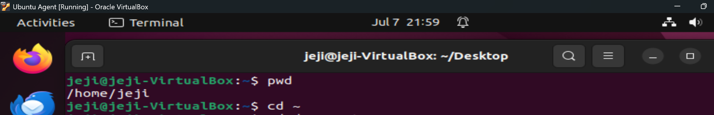
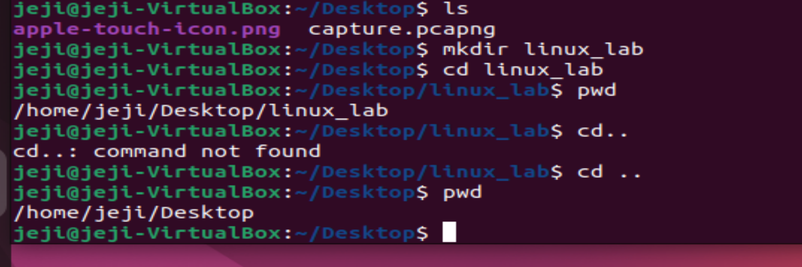
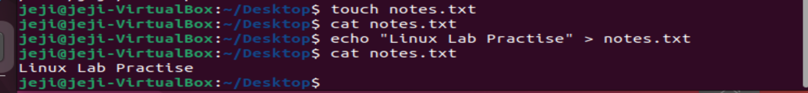
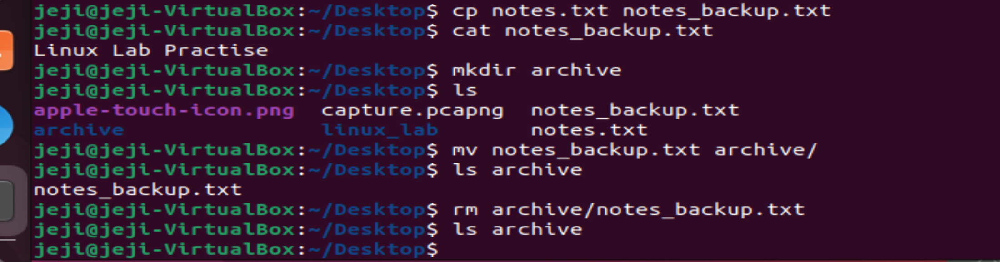
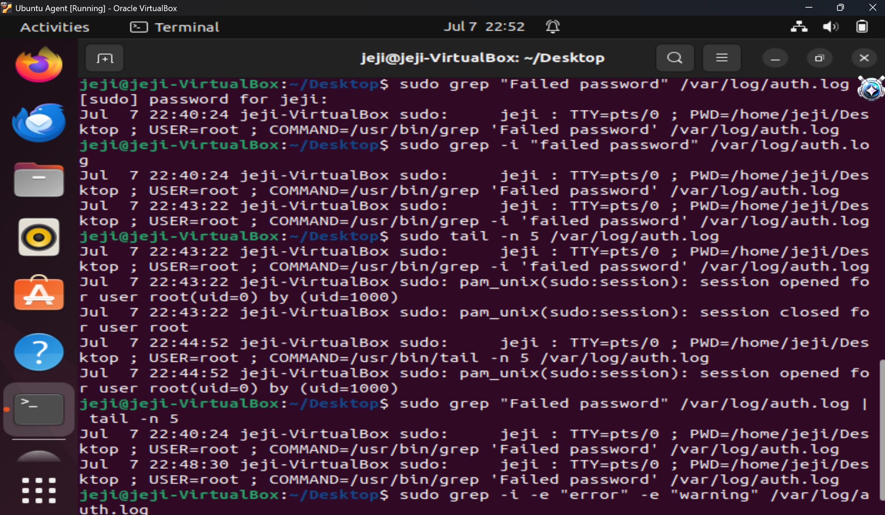

# Lab 1 — Linux Basic Commands

**Series:** Blue Team Build Log  
**Environment:** Ubuntu (VirtualBox)  
**Topics:** Directory Navigation · File Management · Permissions · Log Analysis

---

## Overview

This lab covers the foundational Linux terminal commands used daily by SOC analysts and blue team practitioners. Starting from basic navigation and building up to real authentication log analysis using `grep` and `tail`.

---

## Task 1 — Directory Navigation and Files

### 1.1 Navigation Basics
Using `pwd` and `cd` to navigate the Linux filesystem.



---

### 1.2 Listing and Directory Creation
Using `ls` to list contents and `mkdir` to create directories.


---

### 1.3 File Creation and Viewing
Using `touch`, `echo`, and `cat` to create and read files.



---

### 1.4 Copy, Move, Remove
Using `cp`, `mv`, and `rm` for file management.



---

## Task 2 — Permissions and Log Analysis

### 2.1 Changing and Verifying Permissions
Using `chmod 444` to set a file as read-only and `ls -l` to verify.



---

### 2.2 grep and tail — Real Log Analysis
Searching `/var/log/auth.log` for authentication events using `grep` and `tail`.




---

## Commands Reference

```bash
# Navigation
pwd                                              # Print current directory
cd ~                                             # Go to home directory
cd ~/Desktop                                     # Go to Desktop
cd ..                                            # Go up one level
ls                                               # List directory contents
ls -l filename                                   # Detailed file info

# File Management
touch filename.txt                               # Create empty file
echo "text" > file.txt                           # Write to file
cat file.txt                                     # Read file contents
cp source.txt dest.txt                           # Copy file
mv file.txt folder/                              # Move file
rm folder/file.txt                               # Delete file (permanent!)

# Permissions
chmod 444 file.txt                               # Set read-only for all

# Log Analysis
sudo grep "Failed password" /var/log/auth.log    # Search for failed logins
sudo grep -i "failed password" /var/log/auth.log # Case-insensitive search
sudo tail -n 5 /var/log/auth.log                 # Last 5 log lines
sudo grep "Failed password" /var/log/auth.log | tail -n 5  # Combined
sudo grep -i -e "error" -e "warning" /var/log/auth.log     # Multi-pattern
```

---

## Key Takeaways

- `pwd` before any command — always know where you are
- `chmod 444` protects log files from tampering — mirrors real SOC practice
- `grep` filters signal from noise in large log files
- Pipe `|` chains commands together for powerful one-liners
- Every `sudo` command gets logged — full audit trail

---

*Part of the [Blue Team Build Log](https://github.com/Jeji-James-Cyber/blue-team-build-log) — documenting my homelab journey toward SOC Analyst.*
